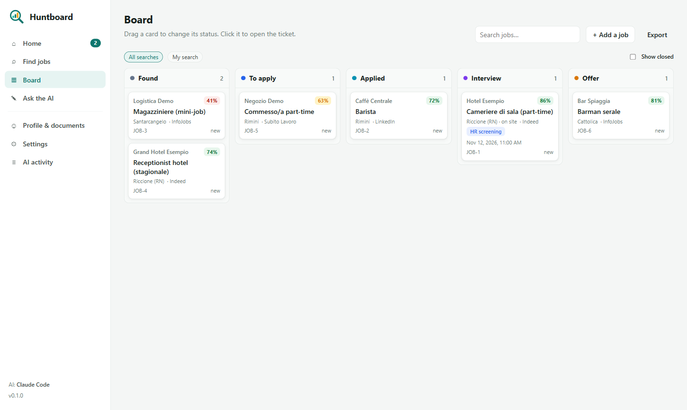
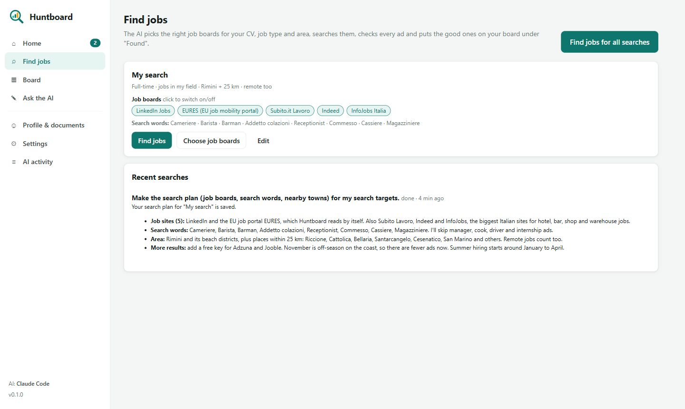
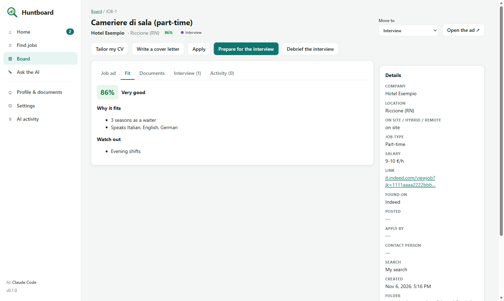
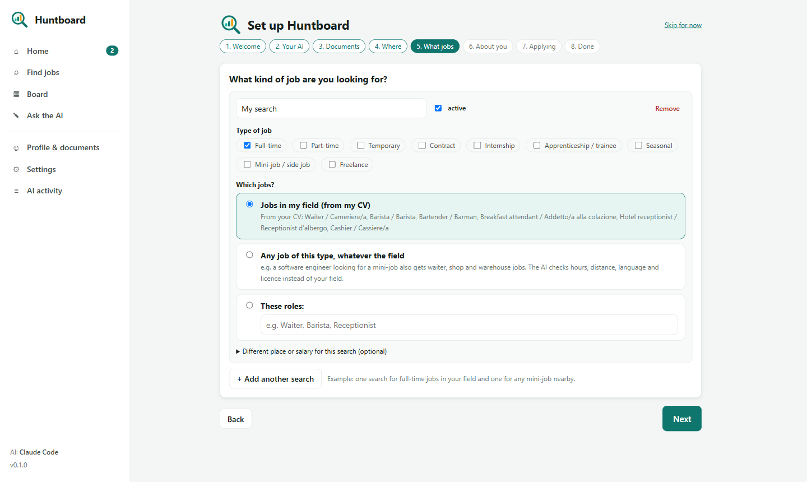
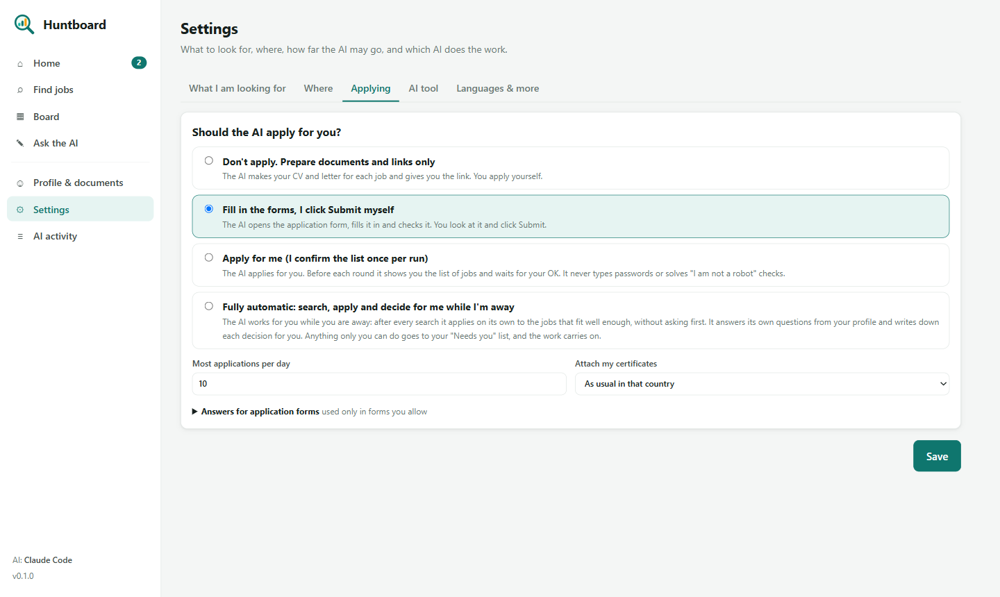

<p align="center">
  <picture>
    <source media="(prefers-color-scheme: dark)" srcset="assets/logo/huntboard-logo-dark.svg">
    
  </picture>
</p>

<p align="center"><b>Your CV in. The right jobs, tailored applications and interview prep out, with the AI you already use.</b></p>

<p align="center">
  <a href="https://github.com/jacobjoseph-96/Huntboard/actions/workflows/ci.yml"></a>
  
  
</p>

Huntboard is a free app for job seekers that runs on your own computer. You upload your CV and documents, say what
kind of job you want and where you live, and the AI tool you already have does the work:

- **Finds jobs that fit.** It picks the right job boards for your country, field and job type (full-time,
  part-time, mini-job, seasonal, internship…), searches them, reads every ad and scores how well it fits you, with
  reasons and red flags. Want *any* side job, not only jobs in your field? Say so, and it judges what you can do
  (hours, distance, language, licence) instead. Once a day it also searches the web for company career boards
  (Greenhouse, Lever, Ashby, Personio, Recruitee, SmartRecruiters), where many companies post before the big boards
  get the ad, and reads those boards from then on.
- **Tracks everything as tickets** on a board: Found → To apply → Applied → Interview → Offer → Closed, with the
  full ad text, notes and history of every job.
- **Writes your documents:** a CV in the language and style of the country you apply in, tailored to each job, cover
  letters, an attachments PDF and e-mail drafts, all checked against your real data.
- **Applies, as far as you allow:** prepare only · fill in the forms for you to submit · apply after you OK the list ·
  **fully automatic** while you are away: it decides for you from your profile, writes every decision down and leaves
  only what truly needs you (robot checks, logins) on a "Needs you" list.
- **Takes your instructions per job:** each ticket has an "Instructions for the AI" box ("it is fine to replace the
  stored CV on that board: remove it, then attach the new one"). Every AI task on that job reads it, and a "Needs you"
  item can be answered there and tried again. Every file on a ticket shows its full path, with Copy path and Show in
  folder, for attaching it to a form or an e-mail yourself.
- **Prepares you for every interview step:** recruiter call, HR screen, technical interview, take-home task, trial
  shift, panel, final round, offer negotiation. Afterwards it debriefs with you, drafts the thank-you note and
  prepares the next round.

<p align="center"></p>

## Works with your AI

Huntboard has no AI and no account of its own. It runs the AI tool installed on your computer, with your own
subscription or free plan, in the background, and shows its progress in the app.

| AI tool | Status |
|---|---|
| Claude Code | supported |
| Antigravity CLI (Gemini) | supported |
| Gemini CLI | experimental |
| Codex CLI | experimental |
| OpenCode: any model (OpenAI, Anthropic, OpenRouter, Ollama, LM Studio…) | experimental |
| GitHub Copilot CLI | experimental |
| Cursor CLI | experimental |

The instructions for the AI live in one place (`agent/`) and are written for every tool, so you can also open the
folder in any of these tools and just talk to it. Details: [docs/supported-ais.md](docs/supported-ais.md).

## Quick start

**Windows:** download or clone this repository, double-click `install.bat` once, then `start.bat`.

**macOS / Linux:** `sh install.sh` once, then `sh start.sh`.

You need Node.js 22+, Google Chrome (or Edge / Chromium) and one AI tool. The installer helps with all three. The
first time, sign in to your AI tool once: open a terminal in the Huntboard folder and start it (for example `claude`,
`gemini` or `agy`).

Huntboard opens in its own window and walks you through the setup: your AI tool, your documents, where you live,
what jobs you want, and how far the AI may go when applying.

| | |
|---|---|
|  |  |
|  |  |

### More job boards (optional)

Many boards work without anything. Adzuna and Jooble need a free API key: copy `.env.example` to `.env` and fill it in.

## Your data stays yours

Everything you add (CV, documents, tickets, settings, browser logins) lives in the `workspace/` folder on your
computer and is never committed to git. It goes to the AI tool you chose, and to employers only when you apply. Job
boards only get search words and a place. The app listens only on your own computer and every request needs a secret
token. More: [docs/privacy.md](docs/privacy.md).

## Problems?

| Problem | What to do |
|---|---|
| "No AI tool is chosen" / "not installed" | Settings → AI tool: pick one; install it with the command shown there. |
| The AI says it is not signed in | Open a terminal in the Huntboard folder, start the tool once (e.g. `claude`, `gemini`, `agy`) and sign in. |
| "usage limit reached" | Your AI plan's limit: wait a few hours, pick another model in Settings, or use another AI tool. |
| "was not allowed to do …" (Antigravity) | Settings → AI tool → "Let the AI work without asking" (only if you are fine with that). |
| A board shows "Verify you are human" | Solve it in the AI's browser window when the app asks you. Huntboard never gets around these checks. |
| The CV is two pages | Ask in the chat: "make the CV fit on one page". |
| Port 4317 is busy | Huntboard is probably already running: `start.bat` opens the existing window. |

## For developers

```
agent/        rules and skills for the AI (single source; `npm run sync` writes AGENTS.md, CLAUDE.md, GEMINI.md…)
app/          the local app (plain JS, no build step) and its API server
boards/       job board registry and browser playbooks
lib/          tickets, profile, documents, search engine, documents rendering, AI runner and adapters
templates/    CV and cover-letter styles, labels per language
tools/        hunt.js (the command-line tool the AI uses), sync-agents.js, export-logo.js
test/         npm test
```

`node tools/hunt.js help` lists every command. How it fits together: [docs/architecture.md](docs/architecture.md).
Adding a board: [docs/adding-a-board.md](docs/adding-a-board.md). Contributing: [CONTRIBUTING.md](CONTRIBUTING.md).

## Feedback

Bugs and ideas: [GitHub issues](https://github.com/jacobjoseph-96/Huntboard/issues).

## License

MIT
